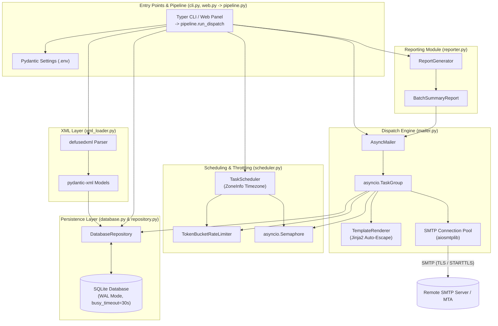
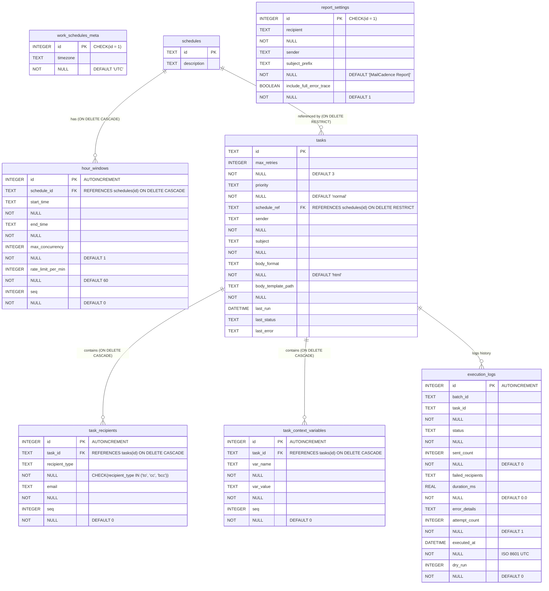
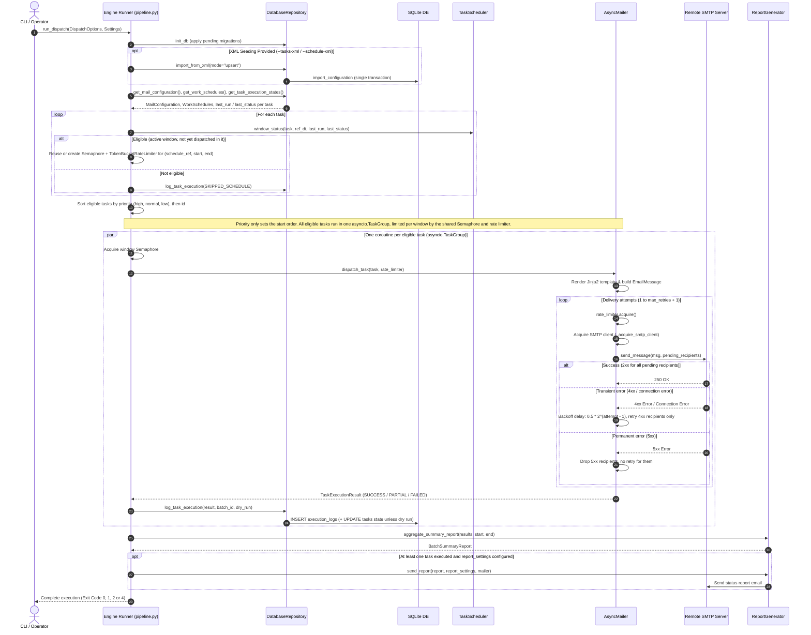
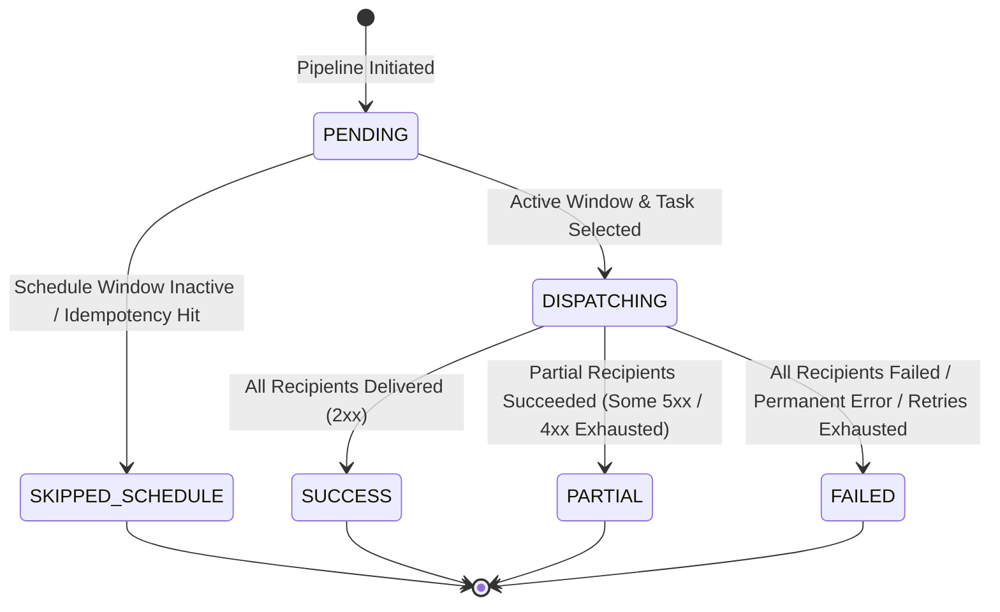

# MailCadence Architecture & Technical Documentation

Comprehensive, engineering-grade architectural specifications, database schema, data flows, and security controls for the `mail-cadence` execution engine.

---

## 1. System Overview & Component Architecture

### Core Modules & Responsibilities

`mail-cadence` is a high-throughput, asynchronous bulk email dispatch engine written in Python 3.12+. It utilizes SQLite for local state persistence and runtime execution tracking, while retaining XML support for schema-validated configuration import and export.

| Module | Location | Primary Responsibilities |
| --- | --- | --- |
| **Dispatch Pipeline** | `src/mail_cadence/pipeline.py` | The single dispatch orchestration used by every entry point: `run_dispatch(DispatchOptions, Settings)` (XML seeding, schedule evaluation, concurrent execution, logging, status report) and `dispatch_single_task` (manual run of one task). Opens its own SQLite connection. |
| **CLI** | `src/mail_cadence/cli.py` | Thin Typer adapter (`dispatch`, `import-xml`, `export-xml`, `serve`): argument parsing, logging setup, settings and `--db` resolution. `run_dispatch_pipeline(...)` is kept as a backward-compatible wrapper over `pipeline.run_dispatch`. |
| **Web Panel** | `src/mail_cadence/web.py` | Thin FastAPI/HTMX adapter. Starts `pipeline` functions in background jobs (`dispatch_jobs.py`); it does not import `cli.py`. |
| **XML Loader & Exporter** | `src/mail_cadence/xml_loader.py` | Secure XML parsing via `defusedxml`, schema validation using `pydantic-xml` models (`MailConfiguration`, `WorkSchedules`), and bidirectional conversion between XML documents and SQLite data models. |
| **Database & Connection Manager** | `src/mail_cadence/database.py` | SQLite connection pooling initialization, database schema DDL execution, journal mode (`WAL`), busy timeout settings, and foreign key enforcements. |
| **Database Repository** | `src/mail_cadence/repository.py` | Data Access Object (DAO) providing transactional database operations (`upsert`, `replace`, state recovery, execution logging). Uses top-level transaction blocks (`with self.conn:`) to maintain single-statement and batch atomicity. |
| **Task Scheduler** | `src/mail_cadence/scheduler.py` | Timezone-aware schedule window evaluation (`zoneinfo`), active execution window calculation (including midnight-spanning window handling), window-level idempotency checking, and token bucket rate-limiting resource management. |
| **Async Mailer & Renderer** | `src/mail_cadence/mailer.py` | Async email dispatch engine using `aiosmtplib`, `asyncio.TaskGroup`, `asyncio.Semaphore`, and `TokenBucketRateLimiter`. Handles Jinja2 template rendering (`TemplateRenderer`), MIME message construction, connection pooling (`AsyncMailer._pool`), and exponential backoff retry logic. |
| **Status Reporter** | `src/mail_cadence/reporter.py` | Aggregates execution results into `BatchSummaryReport` and generates HTML/plain-text summary reports dispatched to operators upon task batch completion. |
| **Domain & Data Models** | `src/mail_cadence/models.py` | Pydantic v2 and `pydantic-xml` models, custom data types (`EmailPriority`, `TaskStatus`, `RecipientType`), string header validators, and Pydantic field transformations. |

---

### Component Architecture Diagram

The following C4 component diagram illustrates component boundaries and data flows across CLI, storage, scheduling, dispatching, and reporting layers:



---

## 2. Database Schema & Entity-Relationship Diagram (ERD)

### SQLite Pragma & Concurrency Configuration

`mail-cadence` configures SQLite for high concurrency, durability, and strict integrity via `database.py`:

- **Write-Ahead Logging (`PRAGMA journal_mode = WAL;`)**: Configured for file-backed databases to allow concurrent readers without blocking write transactions.
- **Busy Timeout (`PRAGMA busy_timeout = 30000;`)**: Wait up to 30,000 ms (30 seconds) on lock contention before raising `sqlite3.OperationalError`.
- **Foreign Key Enforcement (`PRAGMA foreign_keys = ON;`)**: Explicitly enabled per connection to guarantee referential integrity and execute cascade rules.
- **Transaction Atomicity Rules**: Public methods in `DatabaseRepository` execute SQL queries within top-level `with self.conn:` context managers. Private helper methods (`_save_task`, `_save_work_schedules`, etc.) omit `with self.conn:` context managers, allowing them to execute within the parent transaction without triggering premature commits.

---

### Entity-Relationship Diagram (ERD)



### Schema Versioning & Timestamps

- `PRAGMA user_version` stores how many migrations from `database.MIGRATIONS` have been applied. `init_db` runs the missing ones in order and is a no-op on an up-to-date database. A database with a higher version than the code knows is refused (`sqlite3.DatabaseError`; `run` exits with code `1`).
- Migrations: `1` creates the schema and adds columns missing from databases created before versioning; `2` normalizes task rows to the current validation (unknown priorities become `normal`, `max_retries` is clamped to `0..10`); `3` converts old `executed_at` values from SQLite `CURRENT_TIMESTAMP` format to ISO 8601; `4` replaces line breaks in the stored report subject prefix with spaces; `5` adds the execution-state tables of [ADR 0001](adr/0001-execution-state-model.md) and gives every existing task an identity and version 1; `6` converts the old path's `last_run`/`last_status` into executions (a legacy `SUCCESS` blocks its window occurrence, `PARTIAL`/`FAILED` block it as `NEEDS_REVIEW`).
- Execution state (ADR 0001): `task_identities` (stable `uid` per task, retired on delete), `task_versions` and `schedule_versions` are kept in step with the configuration tables by `database.sync_definitions`, which every repository method that writes tasks or schedules calls inside its transaction. `dispatch_runs`, `task_executions`, `execution_recipients`, `delivery_attempts`, `report_deliveries` and `execution_events` drive every real dispatch (see Window-Level Idempotency Protection).
- Every migration is idempotent, because databases created before versioning start at version `0` and run all of them.
- The web panel migrates once in `create_app`; CLI commands and dispatch runs call `init_db` when they open the database.
- All timestamps (`execution_logs.executed_at`, `tasks.last_run`) are stored as ISO 8601 in UTC with an explicit offset (`database.to_utc_iso`, e.g. `2026-10-17T06:15:00+00:00`). The panel shows them as `YYYY-MM-DD HH:MM:SS UTC`.

---

## 3. Domain & XML Data Models (`models.py` & `xml_loader.py`)

### Pydantic & `pydantic-xml` Model Mapping

Data structures map directly between XML elements, Pydantic objects, and SQLite relational tables:

| Pydantic / XML Model | XML Root / Tag | Target SQLite Table(s) | Parsing & Serialization Notes |
| --- | --- | --- | --- |
| `MailConfiguration` | `<MailConfiguration>` | Multi-table container | Root object containing `ReportSettings` and list of `MailTask` instances. |
| `ReportSettings` | `<ReportSettings>` | `report_settings` | Single-row singleton table (`id = 1`). |
| `MailTask` | `<MailTask>` | `tasks`, `task_recipients`, `task_context_variables` | XML attributes: `id`, `max_retries`, `priority`, `schedule_ref`. Elements: `Sender`, `Recipients` (`To`, `Cc`, `Bcc`), `Subject`, `BodyTemplate`, `ContextVariables` (`Var`). |
| `WorkSchedules` | `<WorkSchedules>` | `work_schedules_meta`, `schedules` | Root container with `timezone` attribute mapping to `work_schedules_meta.timezone` (`id = 1`). |
| `Schedule` | `<Schedule>` | `schedules` | XML attribute: `id`, `description`. Contains list of `HourWindow` objects. |
| `HourWindow` | `<HourWindow>` | `hour_windows` | Attributes: `start`, `end`, `days_of_week`, `max_concurrency`, `rate_limit_per_min`. Both ends are inclusive; `end="24:00"` means the end of the day. FK to `schedules.id` (`ON DELETE CASCADE`). |

### Validation Rules

| Field | Rule |
| --- | --- |
| `MailTask.priority` | `EmailPriority`: `high`, `normal` or `low` (case-insensitive on input). |
| `MailTask.max_retries` | Integer `0..10` (`MAX_RETRIES_LIMIT`); attempts = `max_retries + 1`. |
| `MailTask` recipients | At least one address across `To`, `Cc` and `Bcc`. |
| Addresses (`Sender`, `To`, `Cc`, `Bcc`, report `Recipient`/`Sender`) | Exactly one address per entry, bare (`a@example.com`) or with a display name (`Ann <a@example.com>`). An empty task `Sender` falls back to `SMTP_USER`. |
| `MailTask.schedule_ref` | Must reference an existing schedule: XML import fails cross-reference validation, the panel returns `400`. |
| `HourWindow.end` | `HH:MM[:SS]` or `24:00`. A window `00:00`-`23:59` leaves the last minute of the day uncovered; use `24:00`. |

Migration `2` normalizes rows written by older versions: unknown priorities become `normal`, and `max_retries` is clamped to `0..10` (see Schema Versioning).

---

### Seeding Modes: `upsert` vs `replace`

When importing XML files using `DatabaseRepository.save_mail_configuration` and `DatabaseRepository.save_work_schedules`:

1. **`upsert` Mode (Default)**:
   - Updates existing records or inserts new records based on primary key matching (`tasks.id`, `schedules.id`).
   - For `schedules`: replaces child `hour_windows` for matched schedules.
   - For `tasks`: updates task metadata and replaces corresponding `task_recipients` and `task_context_variables`.
2. **`replace` Mode**:
   - Completely clears the target configuration tables prior to insertion (`DELETE FROM tasks`, `DELETE FROM schedules`, etc.).
   - Re-populates the database strictly from the provided XML files.

---

### Complete XML Examples

#### `tasks.xml`
```xml
<?xml version="1.0" encoding="UTF-8"?>
<MailConfiguration>
  <ReportSettings>
    <Recipient>ops-alerts@example.com</Recipient>
    <Sender>mailer-daemon@example.com</Sender>
    <SubjectPrefix>[MailCadence Status Report]</SubjectPrefix>
    <IncludeFullErrorTrace>true</IncludeFullErrorTrace>
  </ReportSettings>
  <Tasks>
    <MailTask id="TASK-001" max_retries="3" priority="high" schedule_ref="SCHED-MORNING">
      <Sender>noreply@example.com</Sender>
      <Recipients>
        <To>client.alpha@example.com</To>
        <To>client.beta@example.com</To>
        <Cc>account.manager@example.com</Cc>
        <Bcc>audit@example.com</Bcc>
      </Recipients>
      <Subject>Daily Operational Dispatch - EMEA</Subject>
      <BodyTemplate format="html">builtin:daily_dispatch.html.j2</BodyTemplate>
      <ContextVariables>
        <Var name="region">EMEA</Var>
        <Var name="report_date">2026-10-17</Var>
      </ContextVariables>
    </MailTask>
  </Tasks>
</MailConfiguration>
```

#### `schedules.xml`
```xml
<?xml version="1.0" encoding="UTF-8"?>
<WorkSchedules timezone="Europe/Warsaw">
  <Schedule id="SCHED-MORNING" description="Morning operational window">
    <AllowedHours>
      <HourWindow start="06:00" end="12:00" max_concurrency="5" rate_limit_per_min="60"/>
    </AllowedHours>
  </Schedule>
  <Schedule id="SCHED-NIGHT" description="Overnight operational window">
    <AllowedHours>
      <HourWindow start="22:00" end="04:00" max_concurrency="2" rate_limit_per_min="30"/>
    </AllowedHours>
  </Schedule>
</WorkSchedules>
```

---

## 4. Scheduling, Idempotency & Rate Limiting (`scheduler.py`)

### Timezone-Aware Eligibility Evaluation

`TaskScheduler` converts system time to the defined IANA timezone (`zoneinfo.ZoneInfo`) configured in `work_schedules_meta.timezone`:

1. Retrieves current timestamp in target timezone `reference_dt = datetime.now(self.timezone)`.
2. Locates `Schedule` matching `task.schedule_ref`.
3. Checks if `reference_dt.time()` falls within any defined `HourWindow` for that schedule.

---

### Midnight-Spanning Execution Windows

For hour windows where `start_time > end_time` (e.g., `22:00` to `04:00`):

- If `reference_dt.time() >= start_time` (`23:00`):
  - `window_start_dt` = `ref_date 22:00`
  - `window_end_dt` = `(ref_date + 1 day) 04:00`
- If `reference_dt.time() < start_time` (`02:00`):
  - `window_start_dt` = `(ref_date - 1 day) 22:00`
  - `window_end_dt` = `ref_date 04:00`

---

### Window-Level Idempotency Protection

Duplicate dispatches are prevented by durable execution state ([ADR 0001](adr/0001-execution-state-model.md)), not by `last_run`:

- `TaskScheduler.window_instance` returns the window occurrence active at the reference time as UTC instants; its key is `"{schedule_id}@{start UTC}"`.
- A real run claims every task for `(task identity, dispatch generation, window key)` (`DatabaseRepository.claim_execution`, `BEGIN IMMEDIATE`). A finished execution for that key skips the task (`SKIPPED_SCHEDULE`, "already executed in this window"); an execution owned by another live worker skips it as `SKIPPED_BUSY`. At most one execution per task is owned at a time. While any other execution of the task has a recipient in `UNKNOWN` (or still `IN_FLIGHT`), no new execution is created and the task is skipped as `SKIPPED_BUSY` with exit code 3 (`ClaimStatus.REVIEW`), whatever the window key, generation or manual idempotency key.
- The message is rendered from the pinned task version and stored before the first attempt. Attempts select only recipients that are due; results are stored per recipient. Accepted and 5xx recipients are never attempted again, 4xx ones are retried within the budget, no attempt starts after the window end, and an unknown outcome is never retried automatically.
- A worker renews its lease every minute; an execution whose lease expired is recovered at the start of the next run: in-flight recipients become `UNKNOWN` (execution `NEEDS_REVIEW`).
- Dry runs read this state (`peek_claim`) and never write it; their logs carry `dry_run = 1`.
- Saving a changed task starts a new dispatch generation (the window can be sent again with the new version) unless `reset_window_state=False`; "Allow Resend" (`POST /tasks/{id}/reset-window`) starts a new generation without a new version.
- `tasks.last_run` / `last_status` remain a projection for the UI and the XML export; only an execution of the task's current version updates them.
- A manual send (`POST /tasks/{id}/run`) ignores the window and uses the key `manual:{idempotency_key}`: the same key reports the earlier send instead of sending again.
- The status report is sent only when at least one task was executed (success, partial, failed or unknown) and `report_settings` is configured. It is stored in `report_deliveries` (`report_store.py`); every run first retries unconfirmed reports from the stored bytes (one attempt per run, three in total, never after a 5xx or an unknown outcome), then sends its own.
- Retention: at the start of every real run, `purge_message_contents` drops the stored bytes of task executions and reports that ended more than 30 days ago (not of `NEEDS_REVIEW` executions); Message-IDs, recipients, attempts and events stay.
- The panel's Executions pages (`/executions`, `/executions/{id}`) show this state and record operator decisions for `UNKNOWN` recipients (`POST /executions/{id}/resolve`, `DatabaseRepository.resolve_unknown`).

---

### Rate Limiting & Concurrency Architecture

`TokenBucketRateLimiter` enforces rate limits per minute using `time.monotonic()`:

- **Token Bucket Refill**: Tokens fill continuously at rate `rate_limit_per_min / 60.0` tokens/sec up to capacity `rate_limit_per_min`.
- **Resource Key Sharing**: The pipeline (`pipeline._partition_eligible_tasks`) groups concurrency semaphores (`asyncio.Semaphore(window.max_concurrency)`) and rate limiters using a composite key: `(schedule_ref, window.start, window.end)`. All tasks sharing the same schedule window share the exact same semaphore and token bucket instance.

---

## 5. Dispatch Pipeline & SMTP Retry Flow (`pipeline.py`, `mailer.py`, `reporter.py`)

### Execution Sequence Diagram



---

### Task Status State Diagram



---

## 6. Security Architecture

`mail-cadence` implements defense-in-depth security measures across input processing, file handling, template rendering, and SMTP header construction:

### 1. XXE & Entity Expansion Protection (`defusedxml`)
- All XML inputs (`tasks.xml`, `schedules.xml`) are parsed via `defusedxml.ElementTree.fromstring` prior to passing DOM nodes into `pydantic-xml`.
- Prevents XML External Entity (XXE) attacks, billion laughs entity expansion, and DTD retrieval attacks.

### 2. Template Resolution & Path Traversal Prevention (`TemplateRenderer`)
- `builtin:<name>` (e.g. `builtin:daily_dispatch.html.j2`) loads a template shipped in the package's `templates/` directory. The internal report templates (`report_email.*`) cannot be used as task templates.
- Any other `<BodyTemplate>` path is resolved only inside the template directory (`--template-dir` / `MAIL_CADENCE_TEMPLATE_DIR`, default: current directory). There are no fallback locations; a missing file raises `jinja2.TemplateNotFound` and the task fails.
- The resolved path must reside within the template directory (`resolved_path.relative_to(base_dir)`). Attempting to reference files outside it raises a `ValueError`.

### 3. Cross-Site Scripting (XSS) Prevention
- The task renderer uses `StrictUndefined`: an undefined variable raises `jinja2.UndefinedError`. `TemplateRenderer.render_task_body` also rejects a body without visible text (`EmptyBodyError`). Both end the task with `FAILED` (`Template rendering error: ...`) before any SMTP call, and make the panel preview return `400`.
- Jinja2 environments (task renderer and status report) use `select_autoescape(enabled_extensions=mailer.AUTOESCAPE_EXTENSIONS, default_for_string=True)`, which enables autoescape for `html`, `htm`, `xml` and the compound `html.j2`, `htm.j2`, `xml.j2` extensions, and for templates rendered from strings.
- Ensures context variables and SMTP error details rendered into HTML emails are auto-escaped. `*.txt.j2` templates are not escaped.

### 5. Web Panel Dispatch Jobs (`dispatch_jobs.py`)
- `POST /dispatch/run` and `POST /tasks/{id}/run` start a background job and return `202` immediately. Each job runs in its own worker thread with a separate event loop and SQLite connection, so long batches never block the web server or exceed proxy timeouts.
- `DispatchRunner.start` checks for a running job and claims the slot atomically; a concurrent request gets `409`.
- Progress: `GET /dispatch/status` (HTML fragment, polls itself every 2 s while running) and `GET /api/dispatch/status` (JSON).
- The slot is per process: run `serve` with a single worker. It does not coordinate with dispatches started from cron/systemd; those rely on window-level idempotency.

### 6. Web Panel Access Control
- Without `ADMIN_USER` and `ADMIN_PASSWORD` every request is refused with `503`. `mail-cadence serve --insecure-no-auth` opts out, and is only accepted with a loopback `--host`.
- State-changing requests (`POST`, `PUT`, `PATCH`, `DELETE`) are rejected with `403` when `Sec-Fetch-Site` is not `same-origin`/`none` or when `Origin` does not match `Host` (CSRF protection for Basic Auth).
- Failed logins are limited per client IP (`login_throttle.LoginThrottle`, created in `create_app` from `ADMIN_LOGIN_MAX_FAILURES` / `ADMIN_LOGIN_WINDOW_SECONDS`, default 10 per 15 minutes, sliding window). The limit is checked before the password, so a blocked client gets `429` + `Retry-After` even with the right password and cannot confirm a guess. Requests without credentials (the browser's first request) are not counted; a successful login clears the counter. State is in memory, per process, bounded to 10,000 clients. The client IP is `request.client.host`, which uvicorn takes from `X-Forwarded-For` only for trusted proxies (`FORWARDED_ALLOW_IPS`, default loopback).

### 7. Web Panel Browser Hardening (`web.py`, `web_static/`)
- Every response carries `Content-Security-Policy: default-src 'self'; script-src 'self'; style-src 'self'; ...; frame-ancestors 'none'`, plus `X-Frame-Options: DENY`, `X-Content-Type-Options: nosniff`, `Referrer-Policy: same-origin`, `Cross-Origin-Opener-Policy` and `Permissions-Policy`. Pages and API responses are `Cache-Control: no-store`; static files are `no-cache` (revalidated by ETag).
- `Referrer-Policy` is `same-origin`, not `no-referrer`: with `no-referrer` browsers send `Origin: null` on form posts, which the same-origin check rejects.
- All browser assets are served by the app from `web_static/` at `/static` (public, they hold no data): the prebuilt Tailwind CSS, htmx, a generated `icons.js` with only the Lucide icons in use, and the Inter / JetBrains Mono fonts with their licenses. Nothing is loaded from a CDN. They are rebuilt from pinned versions in `frontend/package-lock.json` with `make assets`; CI fails if the committed files differ from a fresh build.
- Templates contain no inline JavaScript, event-handler attributes or inline styles. Elements declare `data-on-<event>="action"` and `web_static/app.js` dispatches to the page scripts (`tasks.js`, `schedules.js`). Server data reaches JavaScript only as HTML-escaped `data-*` attributes or `<script type="application/json">` blocks filled with `|tojson`. IDs in URLs use `|urlencode`.
- htmx runs with `allowEval`, `allowScriptTags` and `includeIndicatorStyles` disabled (`<meta name="htmx-config">`), so no `hx-on`, `js:` expressions or inline scripts in swapped HTML.
- The template preview (`GET /tasks/{id}/preview`) has its own `Content-Security-Policy: sandbox; default-src 'none'; ...`: it renders in an opaque origin without scripts, so a template cannot act on the panel. Inline styles and remote images stay allowed because emails use them.

### 8. Credentials & SMTP Transport Security
- `Settings.smtp_password` and `Settings.admin_password` are `pydantic.SecretStr`: they print as `**********` in `repr`, logs, `model_dump()` and tracebacks. The real value is read with `get_secret_value()` only where it is needed: `AsyncMailer._get_smtp_connection` (SMTP login) and `web._credentials_match` (panel login).
- aiosmtplib logs in over a plain connection whenever the server advertises `AUTH`. So with `SMTP_USER` and `SMTP_PASSWORD` set and neither `SMTP_USE_TLS` nor `SMTP_START_TLS` (`Settings.smtp_auth_unencrypted`), real sends are refused (`Settings.smtp_auth_blocked`): `run_dispatch` exits with code `1` before opening the database, and `AsyncMailer(...)` raises `InsecureSMTPAuthError`. `SMTP_ALLOW_INSECURE_AUTH=true` opts out with a warning. Dry runs and injected SMTP clients are not affected. The panel's settings page shows a warning in both cases.
- TLS certificates are verified (aiosmtplib default); there is no setting to turn that off.

### 4. SMTP Header Injection Prevention
- Header string fields (`sender`, `recipient`, `subject`, `subject_prefix`, `to`, `cc`, `bcc`) are validated using `_check_no_newlines` Pydantic validators in `models.py`; address fields additionally go through `_check_email_address` (one parseable address per entry).
- Rejects inputs containing CR (`\r`) or LF (`\n`) characters, preventing SMTP command injection and unauthorized header injection.
